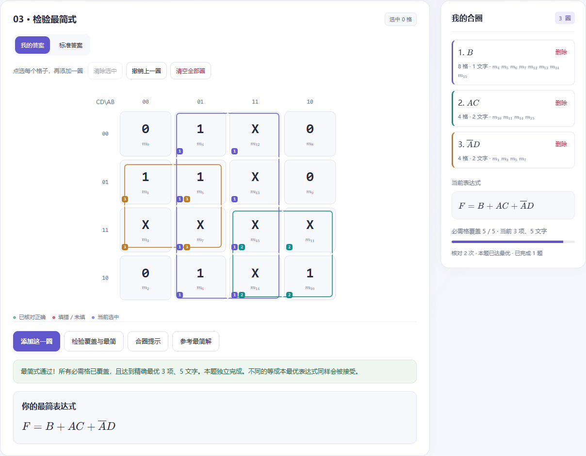
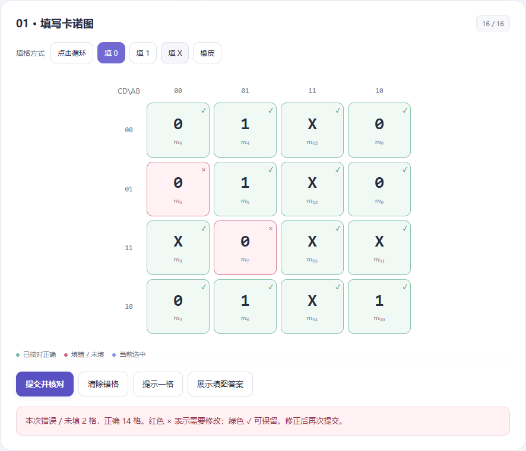
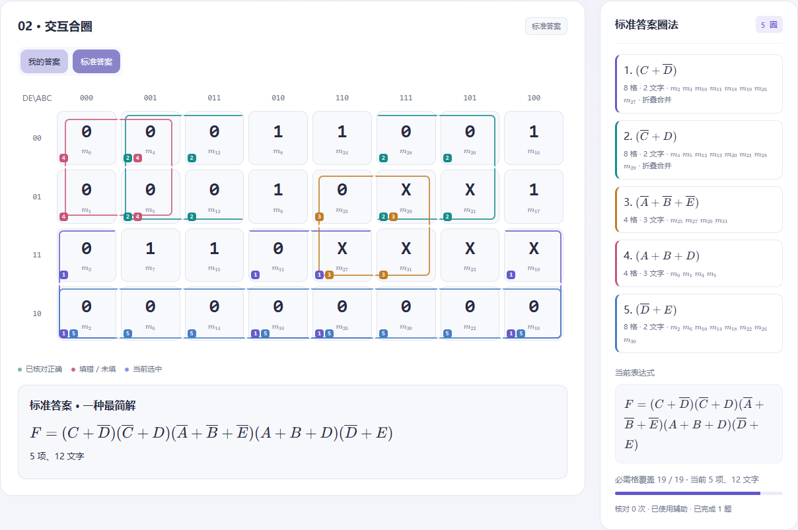

# Karnaugh 图小游戏

**[打开小游戏](https://tijianweijin.github.io/karnaugh_game/)** · 无需注册，打开即可玩 · 支持电脑和手机布局

一个中文卡诺图练习网页，把 **填写真值 → 交互合圈 → 检验最简式** 连成完整的练习流程。默认四变量，也支持三变量和五变量，适合数字电子技术课程中的日常练习。



*实际界面截图：自己的圈与每圈对应项同步显示，覆盖正确后继续检查是否真正最简。*

## 可以练习什么

- 随机生成非平凡、可化简的函数，可选择入门 / 常规 / 进阶、SOP / POS，以及是否包含约束所致的无关项。
- 逐格填写 0 / 1 / X，提交后标出每格对错和错误数量，可重试、提示或展示答案。

- LaTeX 数学斜体、上横线和最小项下标。
- 低位行、高位列；五变量为 DE\ABC 的 8 列 × 4 行，支持折叠相邻合圈。
- 跨边、跨角圈在对应边缘开口，五变量跨列折叠圈朝连接间隙开口。
- 我的答案 / 标准答案切换，学生圈不会被覆盖。
- 函数通栏、卡诺图与答案区并排的练习工作台，手机端自动改为上下布局。
- 删除其他圈后颜色不变，本机自动保存进度。
- 枚举所有合法蕴含项并精确求覆盖最优成本，接受不同的等成本最简式。
- 无后端、登录或分析追踪；渲染器与字体内嵌，下载 docs/index.html 后也可离线运行。

## 怎么玩

1. 选择参数，点击 **生成题目**。输入题号并使用相同参数，可以复现同一道题。
2. 根据函数和约束填入 **0 / 1 / X**，点击 **提交并核对**。
3. 填对后，点选格子并 **添加这一圈**，右侧实时显示每圈对应项。
4. 点击 **检验覆盖与最简**；需要对照时切换到 **标准答案**，再切回自己的答案继续修改。

键盘也可操作：`Tab` 切换格子，`Enter` 或空格点击当前格子。页面底部可以复制在线分享链接。



*图中故意填错两格：红色 × 标出需要修改的位置，绿色 ✓ 保留正确内容。*

## 三至五变量布局

低位变量放在行，高位变量放在列，按格雷码排列：

| 变量数 | 行变量 | 列变量 | 图的大小 |
| --- | --- | --- | --- |
| 三变量 | C | AB | 4 列 × 2 行 |
| 四变量 | CD | AB | 4 列 × 4 行 |
| 五变量 | DE | ABC | 8 列 × 4 行 |

五变量的列顺序为 `000、001、011、010、110、111、101、100`。同一圈可以分成几个不连续的片段，用相同颜色和编号表示。跨边、跨角的圈在对应边缘开口，折叠跨列圈朝连接间隙开口。窄屏下五变量图可以在图内左右滚动。



*五变量 POS 练习截图：圈 0，可借用 X，参考最简解同时展示圈法和表达式。*

## 如何判定最简

程序枚举全部合法蕴含项，并在主蕴含项上进行精确覆盖搜索。最优成本按以下顺序比较：

1. **项数最少**。
2. 项数相同时，**文字数最少**，每个变量或其反变量计一个文字。

SOP 圈 1，POS 圈 0。一个圈必须包含目标值，可以包含 X，不能包含反值，也不能只含 X。变化变量必须取齐全部组合，因此不会把“看起来像矩形，但变量组合不完整”的圈误判为合法。

程序区分“合法但未覆盖完整”“已覆盖但不最简”和“达到最优”。含 X 的最简解可能不唯一：程序检查实际覆盖和最优成本，**不会要求学生的表达式与参考答案字符串完全相同**。

## 内置例题 2.12(3)

点击 **例题 2.12(3)** 可加载：

$$
F=\overline{A}B\overline{C}+(A\oplus B)C\overline{D}+\overline{A}\overline{C}D,
\qquad AB+CD=0
$$

不满足输入约束的组合填 X。正确 SOP 最简式之一为：

$$
F=B+AC+\overline{A}D
$$

POS 最简式之一为：

$$
F=(A+B+D)(\overline{A}+C)
$$

注意：$B+AC+D$ 是错误答案。在允许输入 $ABCD=1001$，即 $m_9$ 时，原函数为 0，而该错误式为 1。

## 离线使用

下载仓库中的 [docs/index.html](docs/index.html)，用浏览器直接打开即可。它是独立网页文件，数学渲染器、样式和字体均已内嵌，无需联网、安装软件或启动服务器。

全部计算在浏览器本机完成，没有后端、账号系统或分析追踪。浏览器允许本地存储时会自动保存练习进度。

## 本地开发

需要 Node.js 18 或更新版本：

```sh
npm ci
npm test
npm run build
```

| 目录 / 文件 | 用途 |
| --- | --- |
| `src/` | 函数生成、精确求解、交互与页面样式源码 |
| `scripts/build.js` | 将渲染器、字体和源码打包成独立 HTML |
| `tests/` | 独立覆盖算法对照、固定样例与圈线边界回归测试 |
| `docs/` | GitHub Pages 发布目录 |
| [TESTING.md](TESTING.md) | 测试范围与验证结果 |

核心算法已通过 **146,204 项断言、13,852 次求解验证**，包括穷举全部 6,561 张三变量 0 / 1 / X 真值表的 SOP / POS，与独立覆盖算法交叉验证；另有圈线、交互与响应式布局检查。页面底部也提供内置自检。详细结果见 [测试报告](TESTING.md)。

## 部署

GitHub Pages 使用 `main` 分支的 `/docs` 目录。修改源码后先运行 `npm run build`，再提交并推送生成的 `docs/index.html`，即可触发网页更新。

## 第三方许可

公式渲染使用 [KaTeX](https://katex.org/)，其 MIT 许可全文保存在 [THIRD_PARTY_LICENSES.txt](THIRD_PARTY_LICENSES.txt)，并内嵌到成品 HTML。
